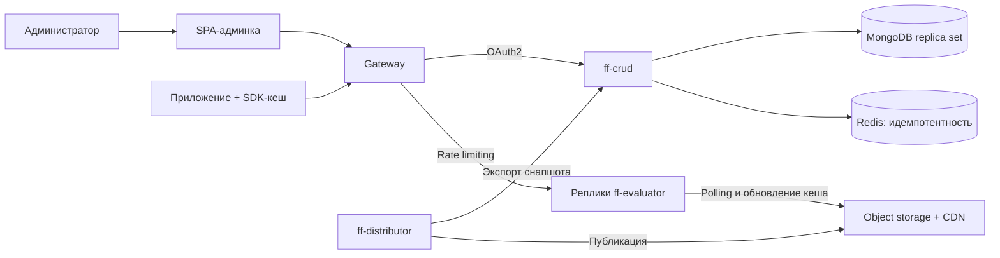

# Итоговое архитектурное решение: Feature Flags Service

Сервис управляет фича-флагами и вычисляет их значения для пользователей.

Драйверы из [Feature Flags Service](overview.md) и [Utility Tree](utility-tree.md): **D1** — 10 000 RPS при p99 ≤ 100 мс; **D2** — доступность evaluator ≥ 99,9% и работа при сбоях; **D3** — обновление конфигурации ≤ 60 с; **D4** — защищённое управление и аудит; **D5** — простота разработки и независимость развёртывания админки и evaluator.

## Декомпозиция: сервисы и границы

| Решение | Документ | Драйвер |
| --- | --- | --- |
| `ff-crud` управляет конфигурацией, `ff-distributor` доставляет снапшоты, `ff-evaluator` вычисляет значения, SDK кеширует их | [Декомпозиция сервисов](solid/service-decomposition.md) | D1, D2: независимое масштабирование и изоляция сбоев |
| Evaluator зависит от контракта снапшота, а не от схемы БД | [ADR: кеширование конфигурации фича-флагов](adrs/0001-adr-flags-cache.md) | D2, D5: независимость контуров |
| Админка — одна SPA с упрощённой FSD; тяжёлый audit-log загружается отдельно | [ADR: тип фронтенда (монолит vs монорепа vs микрофронтенды)](adrs/0002-adr-monolith-frontend.md), [Frontend Project Structure](frontend/project-structure.md), [Frontend Requirements](frontend/requirements.md) | D5: простая разработка без микрофронтендов |

## Взаимодействие и доступ

| Решение | Документ | Драйвер |
| --- | --- | --- |
| Управление и вычисление — синхронные API; доставка снапшотов — фоновый polling | [Синхронные и асинхронные взаимодействия](design/sync-async-interactions.md) | D1, D3: быстрый ответ и обновление ≤ 60 с |
| Gateway разделяет админский и пользовательский трафик; отдельный BFF не нужен | [ADR: API Gateway без BFF](adrs/0003-gateway.md) | D5: короткий путь запроса |
| Админские маршруты защищены OAuth2; `/evaluate` — публичный, с rate limiting | [Аутентификация и авторизация](design/authentication-authorization.md) | D4: защита изменений |
| Повтор изменения обрабатывается по `Idempotency-Key`, контракт API версионируется | [Синхронные и асинхронные взаимодействия](design/sync-async-interactions.md) | D4, D5: защита от дублей и совместимость |

## Надёжность и наблюдаемость

| Решение | Документ | Драйвер |
| --- | --- | --- |
| Реплики evaluator и CRUD, readiness после загрузки снапшота; один активный distributor | [Развёртывание в Kubernetes](design/kubernetes-deployment.md), [Хранилища, шарды и реплики](sharding.md) | D1, D2: масштабирование и доступность |
| При отказе CRUD/БД evaluator использует последний снапшот; при отказе evaluator SDK отдаёт кеш или дефолты | [Карта деградации](degradation-map.md) | D2: продолжение работы при сбоях |
| Контролируем RPS, ошибки, p99 и отставание версий; алерты связаны с SLO | [SLI/SLO for Feature Flags Service](sli-slo.md), [Надёжность и наблюдаемость](observability.md) | D1–D3: измеримые цели эксплуатации |
| Деплой SPA проходит проверки, ephemeral-среду, staging и smoke-тесты перед production | [Frontend Deployment](frontend/deployment.md) | D5: проверяемые релизы |

## Данные и кеш

| Решение | Документ | Драйвер |
| --- | --- | --- |
| MongoDB хранит флаги, версию и аудит; изменения фиксируются атомарно | [Хранилища, шарды и реплики](sharding.md) | D4: согласованная история изменений |
| Полный снапшот публикуется в object storage/CDN; evaluator держит копию в памяти | [ADR: кеширование конфигурации фича-флагов](adrs/0001-adr-flags-cache.md), [Trade-off: Performance vs Consistency](trade-offs/performance-vs-consistency.md) | D1–D3: производительность ценой задержки обновления |
| Шардирование не требуется: нагрузка вычислений не обращается к БД; растущий аудит архивируем | [Хранилища, шарды и реплики](sharding.md) | D1, D5: масштабируем нужный компонент |
| Для БД предусмотрены replica set и бэкапы; Redis хранит ключи идемпотентности 24 ч | [Хранилища, шарды и реплики](sharding.md), [Развёртывание в Kubernetes](design/kubernetes-deployment.md) | D2, D4: восстановление и защита повторных запросов |

## Система одной схемой

## Что осталось открытым

- **Проверка нагрузки:** подтвердить 10 000 RPS при p99 ≤ 100 мс и распространение ≤ 60 с нагрузочными измерениями.
- **Изменение требований:** при необходимости обновлений за несколько секунд пересмотреть polling; при росте БД — проверить условия шардирования. Сценарии расширения описаны в [Изменяемость архитектуры](modifiability.md), риски админки — в [Frontend Risks Matrix](frontend/risks.md).
